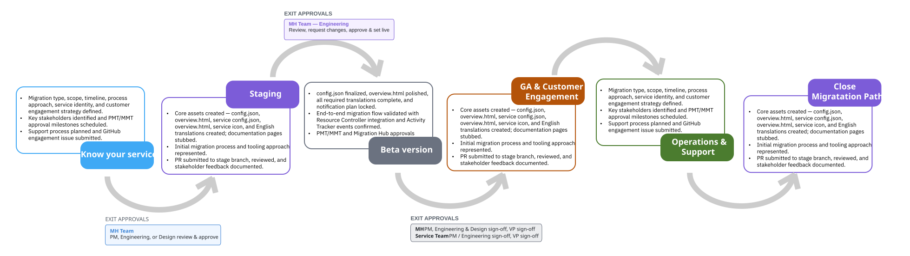

---

copyright:
  years: 2026

lastupdated: "2026-08-04"

keywords: migration hub phases, migration lifecycle, migration engagement overview, migration phase summary, knowing your service, experimental staging, beta, GA, ongoing operations, offboarding

subcollection: migration-service-engagement

content-type: howto

---

{{site.data.keyword.attribute-definition-list}}

# Migration Hub engagement phases
{: #migration-phases}

The {[mh]} service engagement follows six structured phases, from initial discovery through offboarding. Each phase has defined deliverables and exit criteria that must be met before progressing to the next phase.
{: shortdesc}

{: caption="Migration Hub engagement phases" caption-side="bottom"}

## Phase overview
{: #migration-phases-overview}

The following table summarizes each phase, its primary goal, and the recommended timing relative to your target GA date.

| Phase | Goal | Recommended start before GA |
| ----- | ---- | -------------------------- |
| [Phase 1: Knowing your service]({[link]}-phase-knowing-your-service) | Define scope, identify stakeholders, and register intent with the {[mh]} team | 6+ months |
| [Phase 2: Moving to staging]({[link]}-phase-experimental-staging) | Deploy stub materials to staging and gather early feedback | 4–5 months |
| [Phase 3: Beta testing]({[link]}-phase-beta-approvals) | Refine materials to near-GA quality and obtain all required approvals | 2–3 months |
| [Phase 4: GA delivery and customer engagement]({[link]}-phase-ga-delivery) | Deploy to production and send initial customer notifications | 0 months (GA) |
| [Phase 5: Ongoing operations]({[link]}-phase-ongoing-operations) | Support customers, monitor adoption, and refine content | Post-GA |
| [Phase 6: Offboarding]({[link]}-phase-offboarding) | Retire the migration task after all resources have migrated | Post-completion |
{: caption="Migration Hub engagement phase summary" caption-side="bottom"}

## Who is involved
{: #migration-phases-who}

The people required on your team vary by phase. The following table identifies key roles at each stage.

| Phase | Key people required |
| ----- | ------------------- |
| Phase 1: Knowing your service | Product Management Lead, Development Architect, DevOps Manager, Dev Lead |
| Phase 2: Moving to staging | DevOps Lead, Product Manager |
| Phase 3: Beta testing | DevOps Lead, Product Manager, Design Lead, Development Architect |
| Phase 4: GA delivery and customer engagement | Product Management Lead, DevOps Lead, {[mh]} Platform Team, Support Team |
| Phase 5: Ongoing operations | Product Management Lead, DevOps Lead, Support Team, CSM or TAM or Account Team |
| Phase 6: Offboarding | Product Management Lead, DevOps Lead, {[mh]} Platform Team |
{: caption="Key people required at each Migration Hub engagement phase" caption-side="bottom"}

## Getting started
{: #migration-phases-start}

Begin with phase 1 at least six months before your target GA date. The complete engagement — from initial registration through GA delivery — typically takes 9 to 17 weeks. If your customer deadline is shorter, engage the {[mh]} team immediately.

To start, see [Knowing your service]({[link]}-phase-knowing-your-service).
