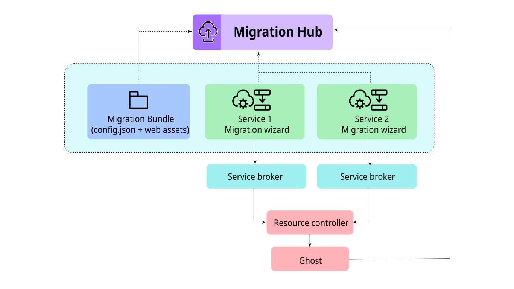

---

copyright:
  years: 2026
lastupdated: "2026-07-14"

keywords: migration hub, resource migration, migration status, migration tools

subcollection: migration-hub

---

{{site.data.keyword.attribute-definition-list}}

# Overview
{: #overview}

Migration Hub is the centralized platform for customers to engage with critical migration procedure when transitioning between IBM Cloud products and services. This focuses on migrations within the IBM Cloud ecosystem, such as migrating from Classic Infrastructure to VPC, between other appropriate products and services, or from deprecated services to their modern replacements. 
{: shortdesc}

Migration Hub provides a unified {{site.data.keyword.cloud_notm}} experience for all migration motions, including Classic to VPC, VMware to OpenShift/VPC VSI, and more. The platform delivers:

- **Unified Migration Experience**: Centralized hub for all IBM Cloud migration activities across different migration paths
- **Real-Time Account Insights**: Live data showing migration blockers, progress tracking, and migration opportunities specific to your account
- **Pluggable Service Integration**: Extensible framework that enables IBM Cloud services to engage customers with key product changes and requirements
- **Self-Service Capabilities**: Independent assessment of affected workloads, migration path planning, and execution through self-service tooling
- **Comprehensive Migration Information**: Access to migration rationale, benefits, costs, timelines, and other critical decision-making data
- **Reduced Friction**: Streamlined transitions between IBM Cloud services with consistent tooling and guidance

## Key capabilities and objectives
{: #capabilities-objectives}

Migration Hub delivers powerful features designed to achieve strategic migration objectives:

Resource Discovery
:   Displays all resources eligible for migration via Lucene queries, accelerating product modernization by reducing time for product-to-product migrations

Migration Status Tracking
:   Shows real-time progress through Resource Controller attributes, improving migration success rates and minimizing service disruption

Service-Specific Wizards
:   Launches dedicated migration tools for each service type, ensuring consistent migration experiences and increasing successful completion rates

Generic Framework
:   Provides reusable content templates for service teams, driving product adoption of modern IBM Cloud services

Customer Self-Service
:   Enables independent workload assessment and migration execution, reducing customer churn by simplifying migration complexity

## Architecture
{: #architecture}

Migration Hub is built as a standard console UI that integrates seamlessly with the {{site.data.keyword.cloud_notm}} platform:

- **Console UI**: Standard console interface (TBD Console 0 / Console Microservice)
- **Migration Wizards**: Launches out to service-specific migration wizards and tools
- **Service Broker Integration**: Eligibility and status information communicated via service broker

{: caption="Migration Hub architecture" caption-side="bottom"}

## Key benefits
{: #key-benefits}

Migration Hub addresses common challenges and pain points in IBM Cloud product migrations:

Centralized Migration Guidance
:   All product migration information consolidated in one location, eliminating fragmented guidance across different product documentation

Clear Migration Paths
:   Guidance for complex product transitions like Classic to VPC, Cloud Foundry to Code Engine, or deprecated service replacements

Expert Product Knowledge
:   Access to specialists who understand both source and target IBM Cloud products

Migration Visibility
:   Centralized view of product migration progress across IBM Cloud services

Consistent Migration Experience
:   Uniform quality of migration support across different IBM Cloud products

Feature Parity Understanding
:   Clear documentation of feature differences between IBM Cloud products

Post-Migration Optimization
:   Guidance for optimizing new IBM Cloud products after migration

